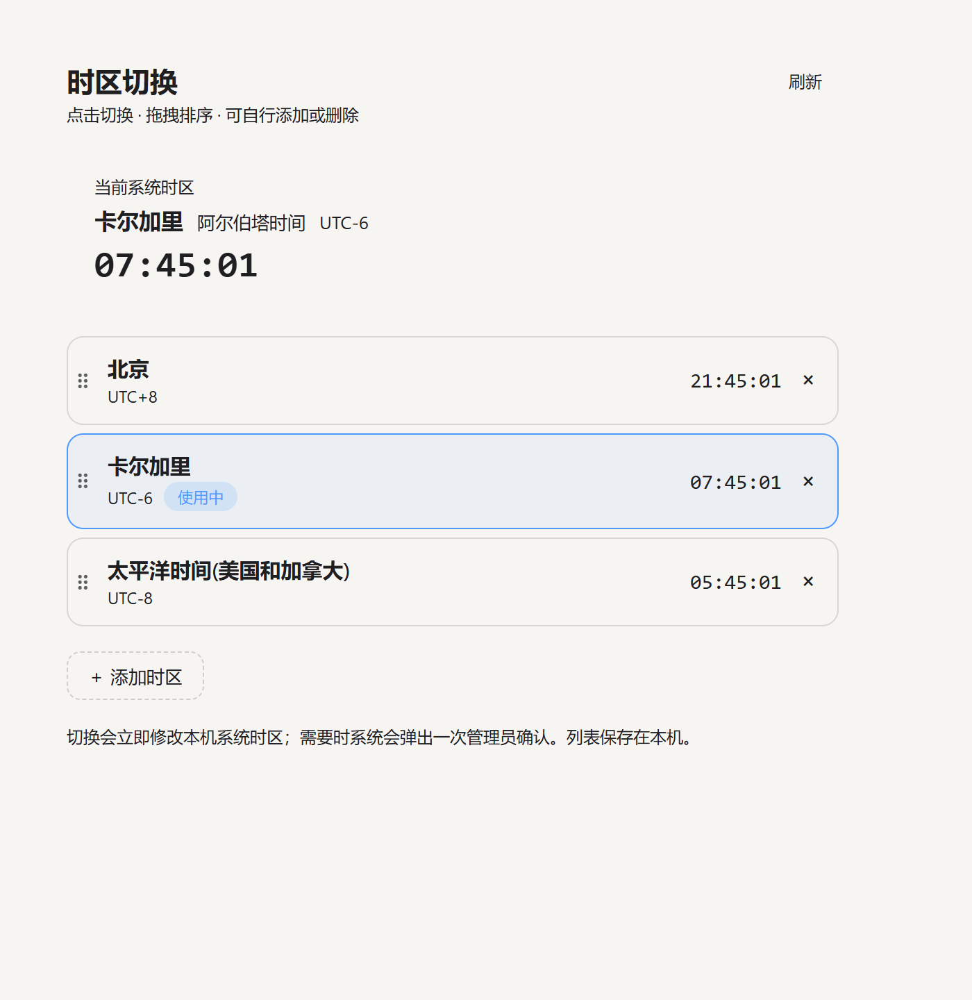

# dsh-tz-switch

给 [DeepSeek Harness](https://github.com/deepseek-ai/deepseek-harness)（DSH）用的 Windows 时区切换插件：在 DSH 界面里点一下就把系统时区切过去，同时看到每个时区的实时时间。



## 功能

- 面板里逐行列出你配置的时区，显示**实时时间**和 UTC 偏移，点击整行即切换（需要时 Windows 弹一次管理员确认）。
- **添加任意时区**：点「＋ 添加时区」，可搜索 Windows 全部 144 个时区（北京、东京、多伦多、伦敦……或按 `UTC+9` 搜）。
- **拖拽排序**：按住行首 `⠿` 拖动；**删除**：行右侧 `×`（至少保留一个）。
- 列表保存在本机 `%USERPROFILE%\.dsh\tz-switch-zones.json`，重启后仍在。
- 当前时区在侧栏/面板里都有实时小钟，和任务栏保持一致。

## 安装

`lib/` 里是预构建产物，装上去就能跑，不需要构建：

```bash
dsh plugin --profile <profile> add github:Caffrey-Li/dsh-tz-switch
```

装完重启一次 DSH（宿主半改动不会热更新），刷新页面即可。

## DS Bot 团队视图

DS Bot 的左侧栏是它自己绘制的（`sidebar.workspaces` 被整体替换，原生侧栏被收成 0 宽），所以插件入口在团队视图里需要一个锚点。仓库里的 `patch/ds-bot-sidebar-anchor.mjs` 会给 DS Bot 的 `client.js` 插入一个空锚点：

```bash
node patch/ds-bot-sidebar-anchor.mjs "<profile>/node_modules/ds-bot/client.js"
```

脚本是幂等的（重复执行不会重复插入），执行后自带 `node --check` 校验。**DS Bot 升级会覆盖 `client.js`，届时重跑一次即可。** 不用 DS Bot 的话可以忽略这一步。

## 时区数据说明

插件不盲信运行时的时区库，几个地方按已发布的规则算：

| 时区 | 规则 |
| --- | --- |
| 北京 | UTC+8，无夏令时 |
| 卡尔加里（阿尔伯塔） | 2026-11-01 起全年 UTC-6（Alberta Official Time Act，不再回拨） |
| 美国西海岸 | 夏令时：3 月第 2 个周日 → 11 月第 1 个周日 |

其余任意时区的偏移取自 Windows 自己的时区数据（`[System.TimeZoneInfo]::GetUtcOffset`）。

**如果你的 Windows 时区库没更新**（例如某些版本仍让阿尔伯塔在 11 月回拨到 UTC-7），面板会显示一条黄色提示；此时切换「卡尔加里」会自动改用一个同样 UTC-6、全年无夏令时的系统时区（`Canada Central Standard Time`），让任务栏和面板一致。Windows 更新后点一次「卡尔加里」会换回原生时区。

## 卸载

```bash
dsh plugin --profile <profile> remove dsh-tz-switch
```

DS Bot 的锚点补丁是就地插入的一行空 `div`，重装 DS Bot 即可还原。

## License

MIT
